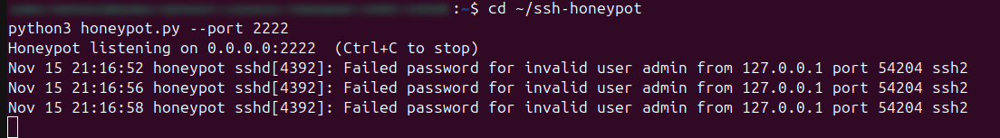
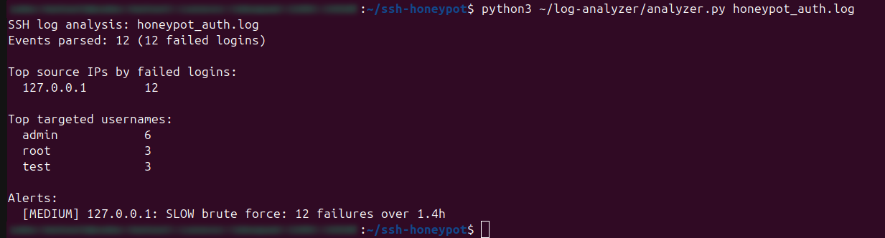

# ssh-honeypot

A minimal SSH honeypot in Python. It pretends to be an OpenSSH server, **rejects every login**, and records who tried and what they guessed. The log format matches sshd, so it feeds straight into [ssh-log-analyzer](https://github.com/HasnainSec/ssh-log-analyzer).

```
 attacker / bot            honeypot.py                      analysis
 ─────────────           ─────────────               ─────────────────────
  tries login  ───────►  always says "no"   ──┬──►  honeypot_auth.log ──► ssh-log-analyzer
  (admin/123456)         never opens a shell  │      (sshd-style lines)     (alerts, top IPs)
                                              └──►  honeypot_creds.jsonl
                                                     (user, password, client version)
```

## Safety

- Authentication **always fails** and no channel (shell, port forward) is ever opened.
- Refuses to run as root. Uses port 2222 by default.
- Run it on a machine you can afford to lose (a cheap VPS or a VM), not your daily laptop.
- Never forward port 22 of your home router to it.

## Run

```bash
pip install paramiko
python3 honeypot.py --port 2222
```

Test it from the same machine (it will say "Permission denied" every time):

```bash
ssh -p 2222 admin@127.0.0.1
```

Then analyze what it caught:

```bash
python3 ../log-analyzer/analyzer.py honeypot_auth.log
```

## Output

`honeypot_auth.log`
```
Nov 15 19:43:09 honeypot sshd[1304]: Failed password for invalid user admin from 203.0.113.45 port 51234 ssh2
```

`honeypot_creds.jsonl`
```json
{"time": "2026-11-15T19:43:09+0500", "ip": "203.0.113.45", "port": 51234, "username": "admin", "password": "123456", "client_version": "SSH-2.0-libssh_0.9.6"}
```

## Ideas for what to do with the data

- Top usernames and passwords tried
- Which SSH client libraries the bots use (`client_version`)
- Attack volume by hour of day
- GeoIP of source addresses

## Limitations

- Credentials are captured, but there is no fake shell, so you can't see what an attacker would do after logging in.
- A home connection behind NAT will receive no internet traffic. For real data, run it on a VPS.

## Demo

The honeypot rejecting test logins:



The same log analyzed with ssh-log-analyzer:



*Demo data comes from my own test logins on localhost, not real attackers.*
